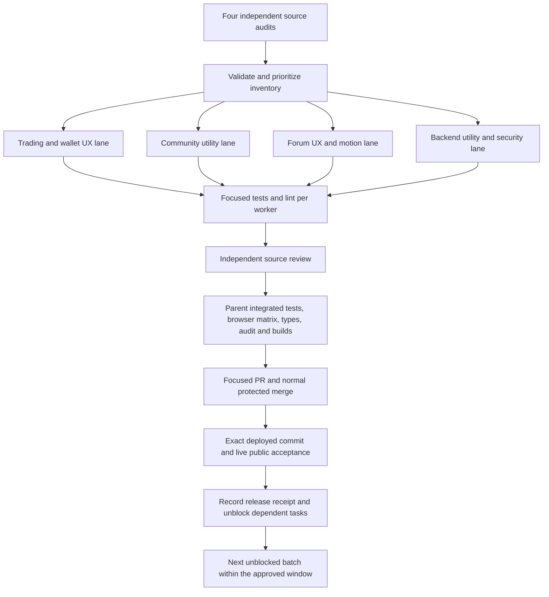

# Forum and Web3 continuous improvement plan

Window: October 31, 2026, 07:45–15:45 UTC (02:45–10:45 America/Chicago).
The owner requested progress follow-ups every 20–30 minutes. The attached
25-minute heartbeat resumes this plan; it is not a second publishing system or
permission to skip checks. Do not begin another batch near the end of the window
unless it can finish review and verification before the deadline. Close with a
shipped/remaining/blocked handoff, then pause the heartbeat.

## Inventory, not a completion claim

`overnight-backlog.json` contains 240 source-backed candidate tasks across four
audit lanes. Each has a stable ID, source location, priority, dependency list and
observable acceptance criterion. Bugs, enhancements, tests and operating checks
are deliberately distinguished. A source review is not proof of a live defect.
Items requiring new authority or an unresolved product choice remain blocked or
marked `needs_confirmation`; they do not enter autonomous batches.

The inventory is a queue, not a promise that 240 independently verified features
fit into one night. Do not count a checklist item as implemented merely because
documentation, an API stub, a fixture or a button exists.

```sh
bun scripts/overnight-backlog.ts
bun scripts/overnight-backlog.ts --ready
```

The checker rejects duplicate/missing IDs, missing dependencies and cycles.
The ready planner only proposes explicitly scoped, non-overlapping tasks whose
prerequisites are deployed. It does not run commands, start agents, merge PRs,
read credentials or call providers. Literal ownership paths are mandatory for
dispatch; globs are not expanded. Shared-file work stays sequential.

## Dependency DAG and dispatch



The task-to-task edges are the machine-readable `dependsOn` lists, not just this
delivery diagram. Missing `paths` means triage is still required. Claim an item
as `in_progress` and assign every file it will change before dispatch. In-flight
items consume capacity. Independent worktrees protect concurrent changes; they
do not make conflicting changes to one shared source file safe to merge blindly.

## First selected batch

| Lane      | Work                                                                          | Owner scope                                              | Status       |
| --------- | ----------------------------------------------------------------------------- | -------------------------------------------------------- | ------------ |
| Community | Prefill an author's existing private work submission, protect dirty edits     | Community hub and isolated submission regressions        | In progress  |
| Forum     | Preserve unsaved profile and notification settings during live query updates  | Control panel and isolated settings regressions          | In progress  |
| Trading   | Select the highest-value confirmed terminal integration issue after the audit | Explicit trading component paths assigned before changes | Audit/triage |
| Parent    | Validated backlog, integration, review and final release checks               | Planning artifacts, shared/generated integration         | In progress  |

Follow-on candidates include shareable utility-section navigation, clearer
sampled-market provenance, project-directory search over already loaded data,
keyboard and mobile interaction polish, purposeful state transitions, source
transparency and better links between discussions, exact mints and utility
surfaces. Their presence here does not mean they are shipped or approved to
change financial behavior.

## Non-negotiable boundaries

- Preserve existing fees, treasury, pricing, models, budgets, schedules, free-tier
  request caps, auth ownership, visibility rules, failure circuits and all holds.
- No inference or publication canaries, replayed uncertain operations, signed or
  sent payments, refunds, hold releases, provider upgrades, paid subscriptions,
  autonomous social posts or email sends. No destructive board/account migration.
- Reuse the one existing wallet, swap, quote/simulation and payment-verification
  paths. Never add a competing provider or treat missing history as non-payment.
- Keep x402 charging fail-closed until its existing readiness requirements pass.
  A fixture is not a real wallet/provider acceptance receipt.
- Never expose private messages, drafts, member/subscriber data, credentials,
  raw provider bodies or private operating metadata in a public PR.
- Do not change agent settings to produce visible activity for a demo. UI motion
  must respect reduced motion and never fabricate live market or agent events.
- Read repository instructions, generated Convex guidance before backend work,
  and installed Next.js documentation before relevant application edits.
- Keep unrelated worktrees and user changes intact. Use explicit-path staging.
  Commits are by `SYMBaiEX <solsymbaiex@gmail.com>`, no co-author, `[skip ci]`.
  Do not enable GitHub Actions or bypass retained merge protections.

## Qualification and release

Workers own focused source and regression checks. Parent reviews correctness,
security, lifecycle and integration, then tests the exact final candidate:

1. Applicable unit/backend tests and isolated browser regressions with outbound
   provider/payment traffic blocked; desktop, phone and reduced-motion cases.
2. Application and Convex type checks, lint, unsuppressed dependency audits and
   secret scanning. Existing warnings remain disclosed, not silently ignored.
3. Native/generated parity, all five app builds, and any affected worker/SDK
   checks. Do not spend time rebuilding an unchanged remote worker image.
4. Open a focused PR with source changes and real local verification evidence.
   Independently review it, merge normally, and compare the merged tree with
   the tested candidate. If main changed, qualify the combined tree again.
5. Verify the existing website deployment serves the exact merged commit on
   the existing domains, then run bounded public UI acceptance. Keep private
   operating receipts local. Do not open a live trading page merely as a generic
   smoke check if it would start unnecessary provider reads.

UI-only batches do not deploy Convex or change hosting configuration. Backend
work requires its own guarded additive rollout and production-target check.
An unresolved check is recorded as unresolved; HTTP 200 or a static build does
not demonstrate an actual trade, payment, post, email or independent review.

Task state progresses through `queued → in_progress → implemented → tested →
merged → deployed`. Only the last state unblocks dependent tasks; it requires a
release receipt. Keep implemented-but-unverified work distinguishable from
production. Record batch results in `overnight-release-log.md`.

If all tasks are genuinely complete, run a new code-grounded audit and create a
new reviewed inventory within the same window. Do not recycle completed items
or invent defects just to keep agents busy.
